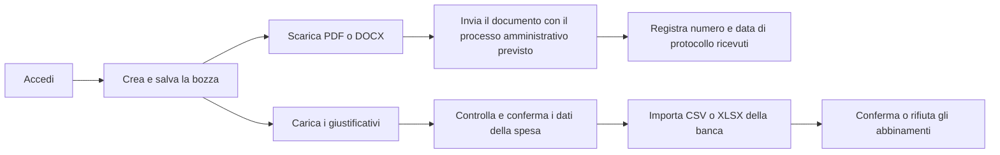
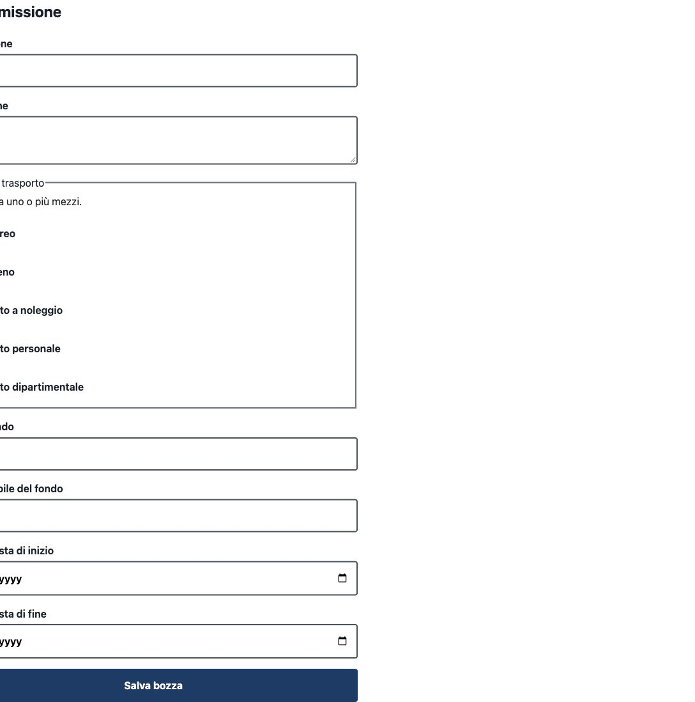
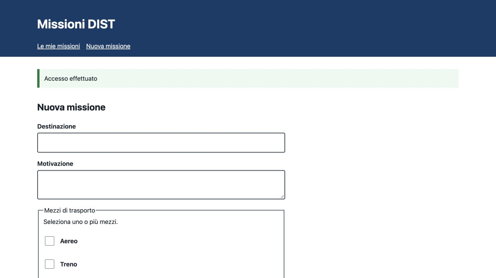
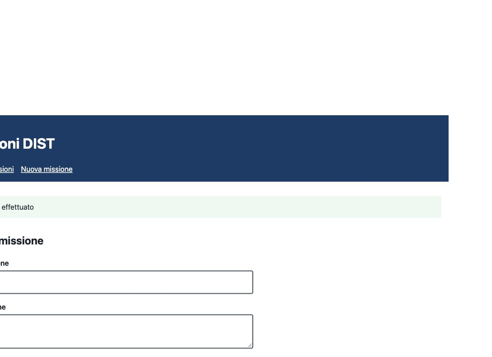
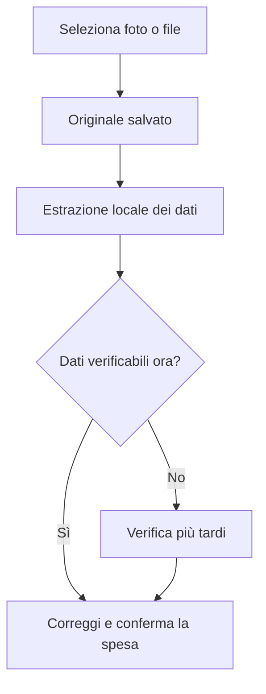
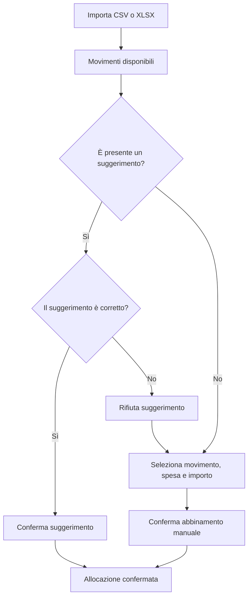

# Guida utente — Missioni DIST

Questa guida descrive il flusso operativo dal punto di vista del **richiedente**, dalla creazione della missione fino alla registrazione del protocollo e alla riconciliazione delle spese.

> **Ambito della demo.** Usare esclusivamente dati sintetici. L'applicazione genera i documenti, ma **non li invia e non li protocolla automaticamente**. Il numero e la data di protocollo vanno registrati solo dopo averli ricevuti tramite il processo amministrativo esterno.

## Flusso in sintesi

I rami dell'autorizzazione e delle spese possono essere completati in momenti diversi. La bozza rimane disponibile nell'elenco **Le mie missioni**.

## 1. Accedere

1. Aprire l'indirizzo dell'applicazione fornito dall'amministratore. Nella demo locale è `http://localhost:5173`.
2. Inserire l'indirizzo e-mail nel campo **Email**.
3. Inserire la password nel campo **Password**.
4. Selezionare **Accedi**.
5. Verificare che compaiano le sezioni **Nuova missione** e **Le mie missioni**.

Per la sola demo sintetica si possono usare le credenziali indicate nel `README.md`. Non riutilizzare la password dimostrativa in altri servizi.

## 2. Creare una missione

1. Aprire **Nuova missione** dal menu principale.
2. Compilare **Destinazione** con la città o il luogo della trasferta.
3. Inserire in **Motivazione** lo scopo della missione in modo sufficientemente dettagliato.
4. Selezionare uno o più **Mezzi di trasporto**:
   - Aereo;
   - Treno;
   - Auto a noleggio;
   - Auto personale;
   - Auto dipartimentale.
5. Inserire il **Codice fondo**.
6. Inserire il **Responsabile del fondo**.
7. Indicare la **Data prevista di inizio** e la **Data prevista di fine**. La data finale non può precedere quella iniziale.
8. Selezionare **Salva bozza**.
9. Attendere il messaggio **Bozza salvata** e verificare che la nuova scheda compaia in **Le mie missioni** con stato `DRAFT`.

Se un campo obbligatorio manca o contiene un valore non valido, il browser lo segnala prima del salvataggio. Correggere il campo indicato e selezionare nuovamente **Salva bozza**.

## 3. Consultare la missione e generare l'autorizzazione

Ogni scheda riporta destinazione, motivazione, periodo, mezzi di trasporto e stato corrente.

1. In **Le mie missioni**, individuare la scheda tramite la destinazione.
2. Controllare periodo e mezzi prima di generare il documento.
3. Selezionare **Scarica PDF** oppure **Scarica DOCX**.
4. Conservare il file scaricato e verificarne il contenuto.
5. Inviare il documento attraverso il canale amministrativo previsto dall'Ateneo, esterno all'applicazione.
6. Dopo la generazione, verificare lo stato `AUTHORIZATION_READY`.

La generazione di un PDF o DOCX non equivale a invio, approvazione o protocollazione.

### Significato degli stati

| Stato | Significato per l'utente | Azione successiva |
| --- | --- | --- |
| `DRAFT` | La missione è una bozza salvata. | Controllare i dati e generare l'autorizzazione. |
| `AUTHORIZATION_READY` | Il documento è stato generato, ma non risulta protocollato. | Inviarlo tramite il processo previsto e attendere il protocollo. |
| `AUTHORIZED` | Numero e data del protocollo ricevuto sono stati registrati. | Conservare le evidenze e proseguire con le spese. |

## 4. Registrare il protocollo ricevuto

Il riquadro **Registra protocollo ricevuto** compare dopo che l'autorizzazione è stata generata.

1. Attendere di ricevere il protocollo dal sistema o dall'ufficio competente.
2. Aprire la scheda della missione in stato `AUTHORIZATION_READY`.
3. Inserire il valore ufficiale nel campo **Numero**.
4. Inserire la relativa **Data**.
5. Ricontrollare entrambi i valori.
6. Selezionare **Registra protocollo**.
7. Verificare il messaggio di conferma e il passaggio allo stato `AUTHORIZED`.

> La registrazione è manuale e non verifica il protocollo presso sistemi esterni. Non inserire valori provvisori o inventati.

## 5. Aggiungere e verificare i giustificativi

### Caricare i documenti

1. Nella scheda della missione, espandere **Giustificativi**.
2. Selezionare **Aggiungi giustificativi**.
3. Scattare una foto oppure scegliere uno o più file JPEG, PNG, WebP o PDF.
4. Attendere il completamento del salvataggio e dell'analisi locale.
5. Selezionare il nome del documento quando compare nell'elenco.

L'originale viene salvato prima dell'analisi. Se lo stesso file è già presente, il sistema evita di creare un duplicato.

### Controllare la proposta di spesa

1. Confrontare l'anteprima **Originale** con i valori in **Verifica dati proposti**.
2. Correggere, se necessario:
   - data;
   - esercente;
   - categoria e descrizione;
   - totale del documento e valuta;
   - importo pagato personalmente;
   - quota richiesta a rimborso;
   - note.
3. Verificare con particolare attenzione **Pagato personalmente** e **Quota richiesta a rimborso**: il totale del documento non determina automaticamente quanto richiedere.
4. Se i dati sono completi, selezionare **Conferma spesa**.
5. Se il controllo deve essere rimandato, selezionare **Verifica più tardi**.

Una proposta estratta è soltanto un aiuto alla compilazione: la responsabilità del controllo resta all'utente.

## 6. Importare l'estratto e riconciliare le spese

1. Espandere **Riconciliazione bancaria** nella scheda della missione.
2. Selezionare **Importa estratto conto CSV o XLSX**.
3. Scegliere l'estratto preparato per la verifica. Nella demo usare soltanto dati sintetici.
4. Attendere il messaggio di importazione. Se il file era già stato importato, il sistema lo segnala senza duplicare i movimenti.
5. Esaminare **Abbinamenti suggeriti da verificare**. Ogni proposta indica la motivazione e non viene applicata automaticamente.
6. Per ogni proposta:
   - selezionare **Conferma suggerimento** se movimento, spesa e importo coincidono;
   - selezionare **Rifiuta suggerimento** se la proposta non è corretta.
7. Per un abbinamento manuale, scegliere **Movimento** e **Spesa**, inserire **Importo allocato**, quindi selezionare **Conferma abbinamento**.
8. Ripetere il controllo finché i movimenti rilevanti risultano riconciliati.

Un movimento può coprire più spese e una spesa può essere ripartita su più movimenti, purché gli importi non siano sovra-allocati. Controllare sempre valuta, data, descrizione e importo.

## 7. Controllo finale

Prima di considerare concluso il lavoro, verificare che:

- destinazione, motivazione, periodo e mezzi siano corretti;
- il documento di autorizzazione sia stato scaricato e inoltrato con il processo previsto;
- numero e data del protocollo corrispondano alla comunicazione ufficiale;
- ogni giustificativo sia leggibile e associato alla missione corretta;
- i dati estratti siano stati verificati o risultino esplicitamente da verificare più tardi;
- la quota richiesta a rimborso sia corretta;
- ogni abbinamento bancario sia stato confermato consapevolmente.

## Problemi comuni

| Problema | Cosa fare |
| --- | --- |
| Non è possibile salvare la bozza. | Controllare i campi obbligatori, selezionare almeno un mezzo e verificare le date. |
| Il giustificativo non viene accettato. | Usare JPEG, PNG, WebP o PDF e verificare che il file sia integro e nei limiti configurati. |
| I dati riconosciuti sono errati o incompleti. | Correggerli manualmente confrontandoli con l'originale; in alternativa usare **Verifica più tardi**. |
| L'estratto risulta già importato. | Non importarlo di nuovo: il sistema ha riconosciuto lo stesso contenuto. |
| Un suggerimento non è corretto. | Selezionare **Rifiuta suggerimento** e creare un abbinamento manuale. |
| Non compare il modulo del protocollo. | Generare prima il PDF o il DOCX e verificare che lo stato sia `AUTHORIZATION_READY`. |

Per vincoli di privacy, sicurezza e conservazione consultare [PRIVACY_SECURITY.md](PRIVACY_SECURITY.md). Per i limiti noti della demo consultare [OPEN_QUESTIONS.md](OPEN_QUESTIONS.md).
